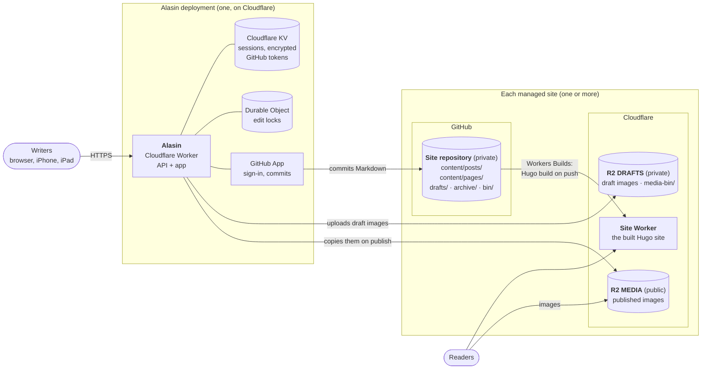

Alasin (Finnish for "anvil") is a web app for writing and publishing pages and posts on a **Hugo site stored in GitHub, hosted on Cloudflare, with images in R2**. It's built for a small group of people who write together and want something as easy as a hosted CMS, especially on iPhone and iPad, without leaving their own Hugo, GitHub and Cloudflare setup.

**[What's New](What's-New.md)**: the latest features, and what each release brought.

## How it fits together

One Alasin deployment serves one or more sites. Each site has its own repository, buckets and Worker; Alasin only reads and writes them.

Where each thing lives:

| What | Where |
| --- | --- |
| **Posts** and **pages** | Markdown in the site repository, in `content/posts/` and `content/pages/` (`[site] posts_dir`, `pages_dir`). Cloudflare builds the site from them on every push. |
| **Drafts** | While typing, on the writer's device only (the browser's storage). *Save draft* commits them to `drafts/` in the site repository, outside Hugo's content, so they're never built. *Publish* moves them into `content/`. |
| **Draft images** | The site's private **DRAFTS** bucket. On publish they're copied to **MEDIA**; the nightly cleanup removes ones no draft uses any more. |
| **Media** (published images) | The site's public **MEDIA** bucket, under `[media] path_pattern`. Never in git, never overwritten. |
| **Archived** posts and pages | `archive/` in the site repository, keeping their original path. |
| **Bin** | Deleted posts, pages and drafts in `bin/` of the site repository; deleted images in the DRAFTS bucket under `media-bin/`. Removed for good only when the Bin is emptied. |
| **Sign-in** | Sessions and encrypted GitHub tokens in the deployment's KV; edit locks in a Durable Object. Nothing about the site's content. |

## Running a site with Alasin

For the person who sets up and looks after a site and its Alasin:

1. **[Before You Start](Before-You-Start.md)**: the accounts and tools you need.
2. Then one of:
   - **[New Site](New-Site.md)**: no site yet. One command creates the site repository, its buckets, the site's Worker and Alasin. About 30 minutes.
   - **[Existing Site](Existing-Site.md)**: a Hugo site already deployed on Cloudflare, with its images in R2. About 20 minutes.
3. Day to day:
   - **[Users and Access](Users-and-Access.md)**: who can sign in, and how to add and remove people.
   - **[Authors](Authors.md)**: how posts record who wrote them, and showing it on the site.
   - **[Updating](Updating.md)** to a new release.
   - **[Housekeeping](Housekeeping.md)**: rotating secrets, the nightly cleanup, reminders.
   - **[Removing a Site](Removing-a-Site.md)** that `create-site` made.
4. Reference:
   - **[Configuration](Configuration.md)**: every option of `alasin.toml`.
   - **[Configuration Files](Configuration-Files.md)**: where each site's configuration lives, and several sites in one clone.
   - **[Security](Security.md)**: how sign-in, sessions, tokens and data are protected.
   - **[Troubleshooting](Troubleshooting.md)**.

## Developing and testing Alasin

For contributors, and for anyone testing a new version before it's released:

- **[Development](Development.md)**: running Alasin on your computer, and how the code is laid out.
- **[Test Environment](Test-Environment.md)**: a dev site with sample content and its own Alasin with a **DEV** badge, which can be reset after each test.
- **[Testing](Testing.md)**: automated tests, and the manual test runs.
- How changes are named, reviewed and released: [CONTRIBUTING.md](https://github.com/alasin-app/alasin/blob/main/CONTRIBUTING.md) in the repository.

Ideas and plans are in the project's [issues](https://github.com/alasin-app/alasin/issues). Report vulnerabilities as described in [SECURITY.md](https://github.com/alasin-app/alasin/blob/main/SECURITY.md), not in public issues.
